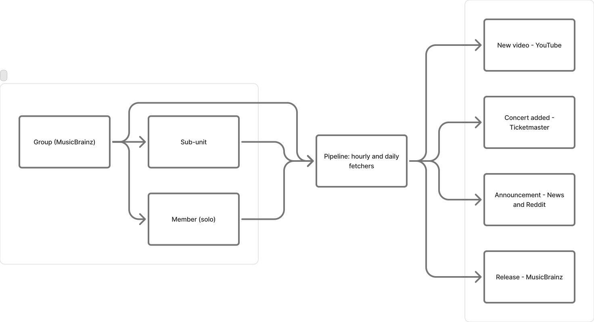
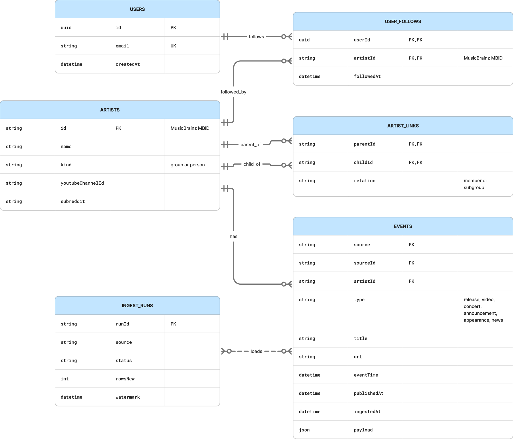
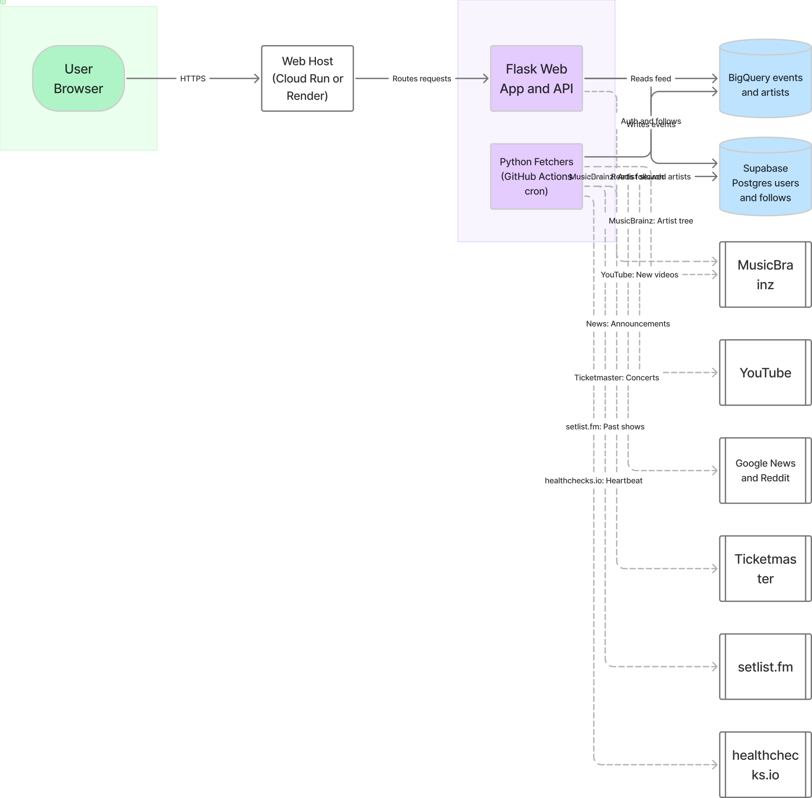
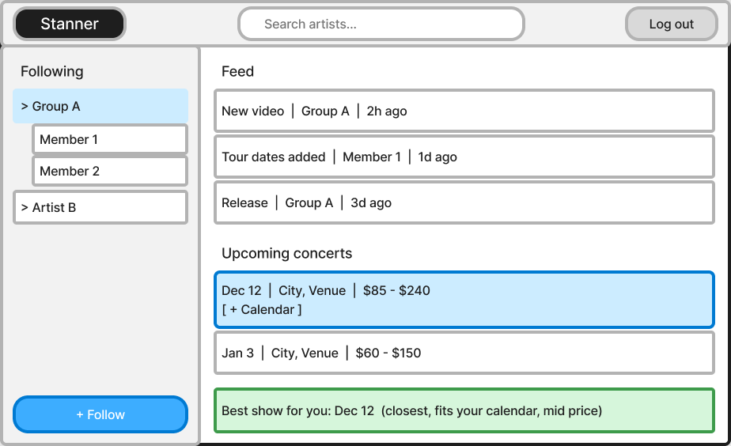

# Stanner: Initial Design

CS 452 Final Project. Lincoln Neilsen. Repo: <https://github.com/LincolnNeilsen/Stanner>

## 1. Purpose and goals

**Stanner is a "what is my favorite artist up to?" tracker.** Follow a K-pop group, band, or solo artist once, and Stanner keeps a single feed of everything they do: new releases, announcements, videos and vlogs, concert and tour dates, and TV or variety-show appearances. Following a group also follows its sub-units and each member, so a member's solo project shows up without you having to look for it.

*Diagram made in FigJam ([board](https://www.figma.com/board/0RuyTM0kufOozDM4e9NMDi)).*

**What already exists** (built for the pipeline assignment): a scheduled Python pipeline (GitHub Actions) that pulls MusicBrainz, YouTube, Google News, Reddit, Ticketmaster, and setlist.fm into BigQuery; a one-time seed; bronze/silver/gold SQL views; and a local Flask viewer.

**Current problem: the pipeline is failing.** The pipeline from the earlier assignment is not running reliably right now, and the data it does collect is thin and inconsistent. The final project cannot answer useful questions until that is fixed, so **repairing and hardening the data collection is the first piece of work**, before any of the web app. See section 1a.

**What the final project adds:** turn the single-user pipeline into a **multi-user web app** that answers real concert questions. People create accounts, follow their own artists, and see a personal feed on a hosted site.

### Questions the project should answer
These two drive the design. Every feature is there to answer one of them well.

1. **"What is the best concert for me to go to for artist ____?"** Compare the artist's upcoming shows (including members' solo shows) by date, distance from the user, ticket price, and whether it fits their calendar.
2. **"When is artist ____'s next ____?"** Next concert, next release, next video, next appearance. The user picks the artist and the event type, and gets a date.

### Goals
1. **Fix the failing pipeline** and make it reliable and consistent (section 1a).
2. **Scrape better, more consistent data** from every source, with checks that tell me when a source goes quiet.
3. **Make Ticketmaster the main concert source**: upcoming events, venues, dates, and on-sale status for every followed artist.
4. **Concert pricing** where an API provides it (for example Ticketmaster price ranges), shown next to each show.
5. **Tour dates** grouped into one tour per artist, so "next show" and "best show" are easy to answer.
6. **Calendar sync:** add a show to the user's personal calendar (an `.ics` download or feed first; Google Calendar later), and use the calendar to flag conflicts.
7. Accounts: sign up / log in.
8. Search artists (MusicBrainz) and follow or unfollow them.
9. A personal feed and an upcoming-concerts list, filtered to what that user follows.
10. The pipeline fetches for the **union of everyone's follows**, not only mine.
11. Hosted and reachable by a public URL, at about $0.
12. Use AI to build faster, and review what it writes.

### Non-goals (for now)
Push or email notifications, a mobile app, buying tickets inside Stanner, and artists outside MusicBrainz. Pricing and calendar sync are goals, but the first version may be simple (price ranges from the API, and an `.ics` file).

### 1a. Current pipeline problems and fixes
I have not yet diagnosed every failure, so this is the starting list. The first work session is for diagnosing and confirming it.

| Problem | Planned fix |
|---|---|
| Scheduled runs are failing, so the data goes stale | Read the failed GitHub Actions logs, fix the root causes, and re-run until runs are green |
| Data is inconsistent: some sources return little, and artists get matched to the wrong results | Tighten matching to the artist's MusicBrainz ID and known names, and drop results that don't match |
| Hard to see which source is broken | Use `ingest_runs` and the healthchecks.io heartbeat to alert on a source with zero new rows for too long |
| Concert data is the weakest part | Make Ticketmaster the main concert source and use setlist.fm only for past shows |
| One bad source fails the whole run | Isolate each source so one failure doesn't stop the others, and backfill from the watermark next run |
| Free-tier limits and rate limits | Respect the limits (MusicBrainz about 1 request per second; Ticketmaster 5,000 requests per day) and cache what doesn't change |

**How I will know it is fixed:** every source has a successful run in the last day, two runs in a row add no duplicates, and each followed artist has a next concert or a clear "none announced".

## 2. Initial ERD

Two stores, because they do different jobs. **BigQuery** holds the large, append-heavy event data (analytics-style reads). A small **transactional database (Postgres, likely Supabase)** holds users and their follows, which need row-level updates and auth. BigQuery's sandbox has no DML, so it is a poor fit for user data.

*Diagram made in FigJam ([board](https://www.figma.com/board/0RuyTM0kufOozDM4e9NMDi)).*

| Table | Store | New or existing |
|---|---|---|
| `artists`, `artist_links`, `events`, `events_staging`, `ingest_runs` | BigQuery | Existing |
| `followed_artists` (recursive view over the follow tree) | BigQuery | Existing; changes to read follows from all users |
| `users`, `user_follows` | Postgres (Supabase) | **New** |

**Planned additions not yet in the diagram** (to be added once the pipeline is fixed):
- Concert price: `price_min`, `price_max`, and `currency` fields, stored in the `events.payload` JSON first and promoted to columns if they prove useful.
- `tours` (artist, name, start and end date) and a `tour_id` on concert events, so shows group into tours.
- `user_calendar_events` (user, event, synced-at) to record which shows were added to a calendar.

**Open question:** `user_follows` (Postgres) and `artists` (BigQuery) live in different databases, so there is no real foreign key. Options are to mirror the artist list into Postgres, or to have the app join in code. I will decide this when I build it.

## 3. Rough system design

*Diagram made in FigJam ([board](https://www.figma.com/board/0RuyTM0kufOozDM4e9NMDi)). Solid arrows are internal calls; dotted arrows go to outside services.*

| Piece | Technology | Why |
|---|---|---|
| Ingest | Python on GitHub Actions cron | Free for public repos; already working |
| Event store | BigQuery sandbox | Free, plenty of space, already loaded |
| User store and auth | Supabase Postgres + Auth | Free tier, no auth code to hand-roll |
| API | Flask (extends the existing viewer) | Already written |
| Front end | Plain HTML/JS first | Keep it small; revisit if time allows |
| Hosting | Cloud Run or Render free tier (to decide) | Public URL at about $0 |
| Concerts and pricing | Ticketmaster Discovery API (price ranges where given) | Free key, already in the pipeline; needs to be made reliable |
| Calendar | `.ics` export first, Google Calendar API later | `.ics` needs no login or approval |

**Main flows**
- *Follow:* user searches an artist, the app calls MusicBrainz, writes a `user_follows` row, and queues the artist tree for fetching.
- *Ingest:* the cron job reads the union of all followed artist IDs, fetches each source since its watermark, and dedupes into `events`.
- *Feed:* the app reads `events` filtered to the user's followed artists (including the sub-unit and member tree).

**Risks**
- BigQuery read cost and latency per page view. Mitigation: cache, and use the pre-built gold views.
- API rate limits as the number of followed artists grows (MusicBrainz is about 1 request per second).
- The free tier on hosting may cold-start slowly.
- GitHub disables scheduled workflows after 60 days without repo activity.

## 4. Daily goals

Planning assumption: about 30 to 40 hours total, finishing before the in-class presentation. Dates are adjustable and I will update the log as I go.

| Date | Goal |
|---|---|
| Tue 11/24 | Submit this design. Read the failed pipeline runs and list the root causes. |
| Wed 11/25 | Fix the failing sources and get a full green run. Tighten artist matching. |
| Fri 11/27 | Make Ticketmaster reliable: all followed artists, venues, dates, price ranges. Add per-source "gone quiet" alerts. |
| Sat 11/28 | Group concerts into tours. Build the "next ____ for artist ____" query. Pick the user database (Supabase) and hosting. |
| Sun 11/29 | Add `users` and `user_follows`, sign-up / log-in, artist search, and follow / unfollow. Pipeline reads the union of all follows. |
| Mon 11/30 | Per-user feed and upcoming-concerts page, with price shown. Start the "best concert for me" ranking (date, distance, price). |
| Tue 12/1 | `.ics` calendar export and conflict flag. Deploy to a public URL; move secrets to the host's secret store. |
| Wed 12/2 | Test end to end, check the pipeline has kept running, fix bugs. Update the diagrams and write the report. |
| Thu 12/3 | Record a short demo, peer review, and presentation prep. |

**If I fall behind:** the order of importance is (1) a working pipeline, (2) "when is artist ____'s next ____?", (3) accounts and per-user follows, (4) "best concert for me", (5) pricing, (6) calendar sync.

**Optional if time allows:** Google Calendar API sync, email digest, "this year vs. 10-year average" chart per artist, and the buffer layer (Pub/Sub) noted in `HANDOFF.md`.

## 5. Rough UX sketch (optional)

*Wireframe made in FigJam ([board](https://www.figma.com/board/0RuyTM0kufOozDM4e9NMDi)).*
